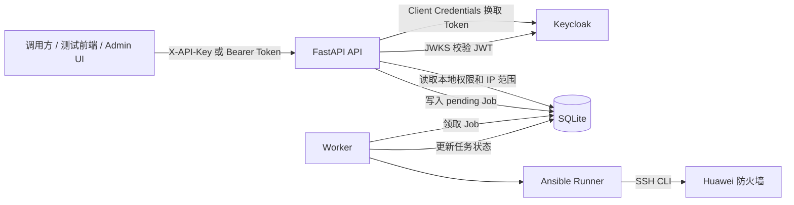
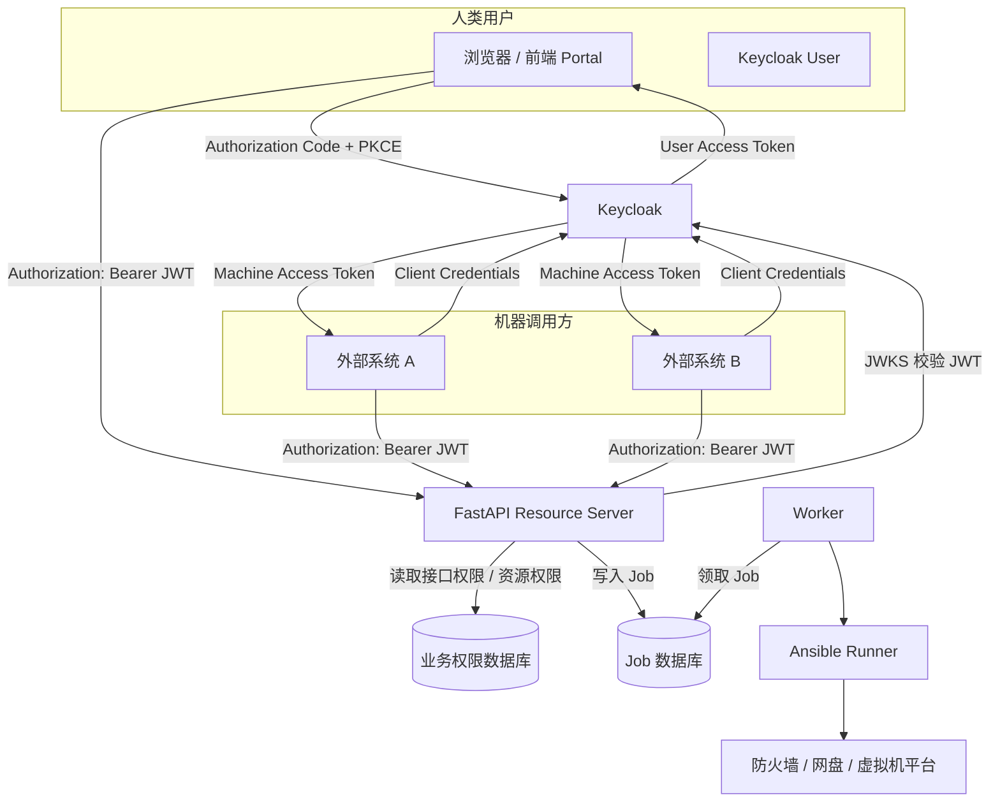
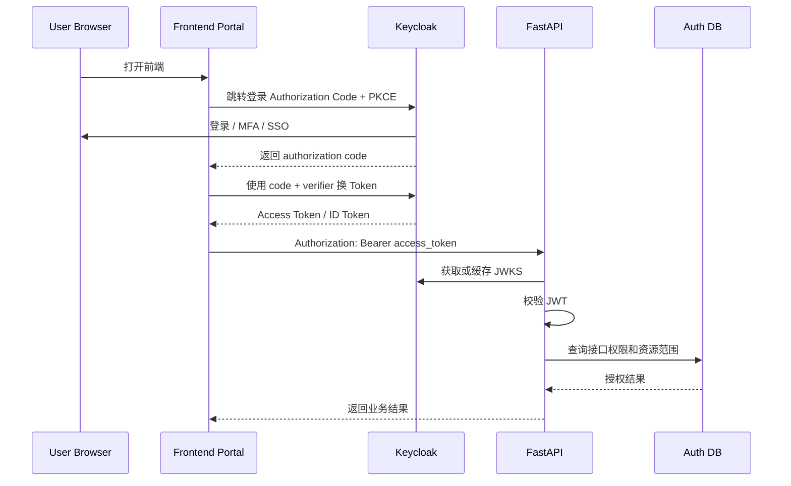
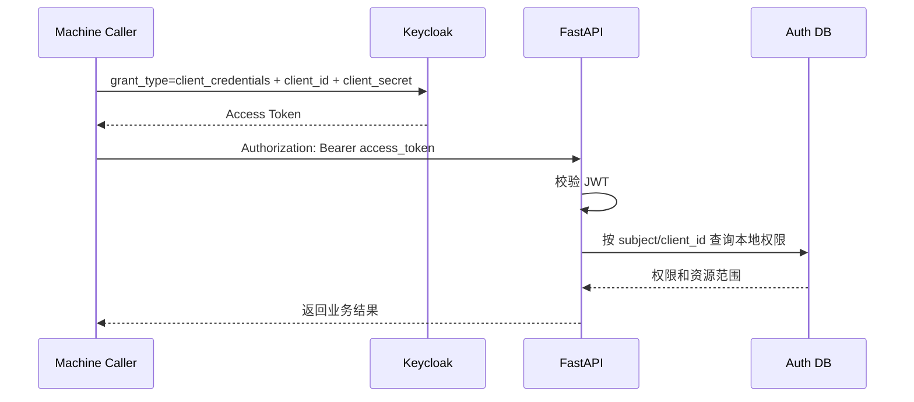
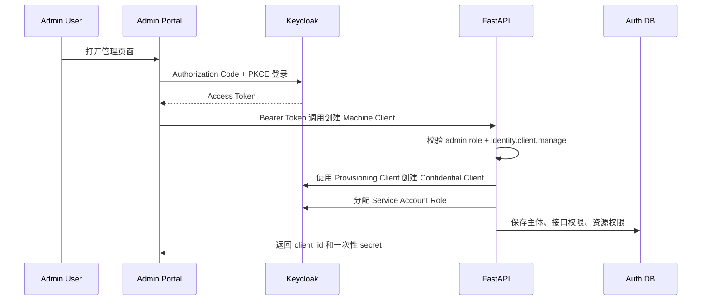

# Keycloak 认证与鉴权标准化改进文档

> **历史设计文档（2026-06-09）：** 当前代码采用“管理员 Keycloak PKCE + 普通用户应用 SK”。
> 本文用于保留标准化讨论过程，不代表当前运行方式。实际配置与接口
> 以 `docs/Keycloak标准认证鉴权实施说明.md` 为准。

> 适用项目：Trade Access API / 后续自动化平台  
> 适用范围：FastAPI + Keycloak + SQLite/PostgreSQL + Worker + Ansible Runner 认证与鉴权体系改造  
> 生成日期：2026-06-09  
> 来源依据：`后端业务逻辑与Keycloak认证鉴权现状说明.md`

---

## 1. 文档目的

本文档用于总结当前 Trade Access API 在 Keycloak 认证与鉴权方面的现状、问题和改进方向，并提出一套更标准、可扩展、可迁移的目标方案。

目标不是重新编写防火墙业务逻辑，也不是把所有业务权限都塞进 Keycloak，而是明确以下边界：

```text
Keycloak 负责：身份认证、Token 签发、用户/客户端/组/粗粒度角色管理。
业务 API 负责：接口鉴权、资源范围鉴权、审批、幂等、任务归属、审计和执行控制。
```

本文档重点解决以下问题：

1. 当前 `X-API-Key -> Client Credentials -> Access Token` 是否标准。
2. 人类用户和机器调用方应如何区分认证流程。
3. Keycloak 中 Realm、Client、Role、Group、Service Account 如何规划。
4. 哪些权限应放在 Keycloak，哪些权限应由业务数据库管理。
5. 如何从当前方案平滑迁移到标准 Bearer Token 模式。
6. 如何支持未来的防火墙放行、网盘申请、虚拟机申请等多个自动化业务。

---

## 2. 当前方案概述

当前系统已经形成完整业务闭环：

```text
调用方提交 X-API-Key 或 Bearer Token
-> FastAPI 认证身份
-> Keycloak 签发或校验 Access Token
-> FastAPI 校验 JWT
-> Keycloak Client Role 做粗粒度身份分类
-> SQLite 本地权限和 allowed_ips 做细粒度授权
-> 写入异步 Job
-> Worker 串行执行 Ansible Runner
-> Ansible 修改华为防火墙
-> API 返回任务状态和事件审计
```

当前总体架构可以概括为：



当前系统中 Keycloak 主要负责：

- 管理调用方 Client。
- 维护 Client Secret。
- 签发短期 Access Token。
- 在 `trade-access-api` Client 下定义粗粒度角色：
  - `trade-access-user`
  - `trade-access-admin`

当前系统中业务 API 主要负责：

- 校验 Token。
- 判断调用方是否具有接口权限。
- 判断普通调用方是否能操作目标 IP。
- 创建 Job。
- 做任务所有权隔离。
- 做审计记录。

---

## 3. 当前方案中合理的部分

以下设计是合理的，改造时应尽量保留。

### 3.1 `trade-access-api` 作为资源 Client

当前 `trade-access-api` 用于代表被保护 API 资源、作为 Access Token 的目标 audience、作为角色命名空间。这符合资源服务的常见设计。

保留建议：

```text
短期：继续保留 trade-access-api。
中长期：如果平台化，可演进为 automation-api，或按业务拆分为 trade-access-api、vm-request-api、storage-request-api。
```

### 3.2 JWT 本地校验

当前 API 校验内容包括：

- JWT 算法。
- Header `kid`。
- JWKS 签名公钥。
- `iss`。
- `aud`。
- `exp`。
- `iat`。
- `sub`。
- `resource_access.trade-access-api.roles`。

这部分是资源服务的标准职责，应保留并强化。

### 3.3 不把业务动态资源塞进 Token

当前没有把以下内容写入 Token：

- IP 列表。
- 端口列表。
- CIDR。
- 防火墙 action。
- 虚拟机规格。
- 网盘产品。
- 审批状态。

这是正确方向。Access Token 不适合承载大量动态业务对象，否则会带来：

- Token 体积膨胀。
- 权限变更无法立即生效。
- 资源授权逻辑难以测试。
- Token 泄露后影响范围不清晰。

### 3.4 服务端强制细粒度鉴权

当前鉴权模型为：

```text
最终允许 = 身份有效
        AND Keycloak 粗粒度角色满足接口要求
        AND 本地操作权限满足接口要求
        AND 普通调用方的目标资源范围满足要求
```

这是正确的。后续仍应坚持：

```text
前端隐藏按钮不等于安全。
Token 有角色不等于拥有所有业务资源权限。
业务资源范围必须由服务端强制校验。
```

### 3.5 Job、Worker、Ansible 执行链路可继续复用

认证鉴权标准化不应推倒重写当前执行链路。以下部分可以继续复用：

- FastAPI 业务接口模型。
- Job 创建与查询。
- 任务所有权隔离。
- Worker 异步执行。
- Ansible Runner 适配。
- 华为防火墙 Ansible Role。
- 任务状态和事件审计。

---

## 4. 当前方案的主要问题

### 4.1 自定义 `X-API-Key` 不是 Keycloak 原生 API Key

当前 `X-API-Key` 格式为：

```text
kc1.<base64url(client_id)>.<base64url(client_secret)>
```

它的实际含义是：

```text
X-API-Key
-> 解析出 client_id 和 client_secret
-> FastAPI 调用 Keycloak Token Endpoint
-> grant_type=client_credentials
-> 获取 Access Token
-> FastAPI 校验 Token 并构造 Principal
```

问题：

1. Base64URL 只是编码，不是加密。
2. `X-API-Key` 等价于长期 Client Secret。
3. 业务 API 接触了调用方长期密钥。
4. 日志、抓包、代理、错误输出一旦泄露 `X-API-Key`，就等同于泄露 Client Secret。
5. 这不是标准资源服务模式。

标准 OAuth2 模式应该是：

```text
调用方 -> Keycloak Token Endpoint -> 获取 Access Token
调用方 -> FastAPI: Authorization: Bearer <access_token>
FastAPI -> 只负责验 Token 和业务鉴权
```

### 4.2 Client 被用来代表员工

当前一个调用方一个 Confidential Client，可以实现独立 Secret 和审计，但它本质上是机器身份。

如果某个 Client 在业务上代表某个员工，例如：

```text
trade-access-zhangsan
```

它仍然不是 Keycloak User，而是 OAuth2 Client / Service Account。

这会导致：

- 无法自然支持员工 SSO。
- 无法自然支持 MFA。
- 无法按员工离职禁用。
- 无法按组织、部门、用户组管理权限。
- 无法记录真实人类用户登录会话。

标准模型应该是：

```text
人类用户 = Keycloak User + Authorization Code Flow with PKCE
机器系统 = Keycloak Confidential Client + Client Credentials
```

### 4.3 管理员通过 `X-API-Key` 使用 Admin UI 不够标准

当前管理员在 `/admin-ui` 输入管理员 `X-API-Key` 来创建调用方 Client。

这在内网测试阶段可以接受，但不适合作为长期平台方案。

标准方案应该是：

```text
管理员打开 Admin Portal
-> 跳转 Keycloak 登录
-> 使用 Authorization Code + PKCE
-> 前端携带用户 Bearer Token 调用 /api/v1/admin/**
-> FastAPI 判断用户是否具有 admin role 和本地管理权限
```

这样可以支持：

- SSO。
- MFA。
- 用户禁用。
- 离职权限回收。
- 管理员组授权。
- 管理员操作审计。

### 4.4 本地权限以 `client_id` 为键，未来不适合真实用户

当前本地权限表主要围绕 `client_id`：

```text
client_permissions
client_allowed_ips
managed_clients
```

这适合机器 Client，但不适合真实用户和用户组。

未来应升级为统一主体模型：

```text
subject_type: user | client | group | service_account
subject_id: Keycloak sub / client_id / group_id
```

这样才能同时支持：

- 员工个人权限。
- 机器系统权限。
- 用户组权限。
- 管理员组权限。
- 审批人权限。

### 4.5 Keycloak 与本地数据库存在双重状态

当前状态分布如下：

```text
Keycloak：Client、Service Account、Client Role。
SQLite：接口权限、allowed_ips、Managed Client 元数据。
```

这种设计本身可以接受，但需要处理一致性问题：

- Keycloak Client 创建成功，但本地数据库写入失败。
- Keycloak 角色变更成功，但本地 profile 更新失败。
- 控制台手工修改 Keycloak 后，本地数据不知道。
- Client 禁用、Secret 轮换和 Token 缓存之间存在短暂失效窗口。

### 4.6 单实例内存缓存不适合多实例生产部署

当前 Token/JWKS 缓存在 FastAPI 进程内。多实例部署时会出现：

- 每个实例缓存不一致。
- Client 禁用后可能有短暂可用窗口。
- 角色变更后旧 Claims 仍可能在某些实例中有效。
- 需要明确是否接受这种延迟。

---

## 5. 改进目标

标准化改造后应达到以下目标。

### 5.1 认证流程标准化

必须区分两类主体：

```text
人类用户：Authorization Code Flow with PKCE
机器调用方：Client Credentials Flow
```

### 5.2 业务权限服务端化

Keycloak 不存储大量动态业务资源。

```text
Keycloak 管：用户、客户端、组、粗粒度角色、Token。
业务系统管：接口权限、IP 范围、虚拟机规格、网盘产品、审批、幂等、限流。
```

### 5.3 Principal 统一化

无论是人类用户还是机器调用方，FastAPI 内部都构造成统一 Principal：

```text
subject_type
subject_id
client_id
username
display_name
roles
auth_type
```

### 5.4 接口权限和资源权限通用化

权限模型不能只适配防火墙业务，应支持：

```text
/api/v1/trade-access/**
/api/v1/storage-requests/**
/api/v1/vm-requests/**
```

### 5.5 平滑迁移

不能一次性破坏现有调用方。迁移策略为：

```text
短期保留 X-API-Key 兼容
新增标准 Bearer Token 主路径
新调用方只走 OAuth2 标准流程
老调用方逐步迁移
最终下线 X-API-Key 包装模式
```

---

## 6. 目标总体架构



目标架构的核心变化：

```text
FastAPI 不再替标准调用方保存或交换长期 Client Secret。
FastAPI 只作为 Resource Server 校验 Bearer Token。
人类用户和机器系统使用不同标准 OAuth2/OIDC 流程。
细粒度业务权限继续由业务数据库管理。
```

---

## 7. Keycloak 对象模型规划

### 7.1 Realm

短期可以继续使用：

```text
trade-access
```

如果系统逐步扩展为通用自动化平台，建议演进为：

```text
automation-platform
```

是否拆多个 Realm 的判断原则：

| 情况 | 建议 |
| --- | --- |
| 用户体系相同、管理员相同、业务只是不同模块 | 使用同一个 Realm |
| 不同业务属于完全不同组织、不同身份源、不同生命周期 | 可以拆分 Realm |
| 只是防火墙、网盘、虚拟机三个业务域 | 不建议拆 Realm |

### 7.2 Resource Client

短期保留：

```text
trade-access-api
```

平台化后建议统一为：

```text
automation-api
```

或者按业务拆分：

```text
trade-access-api
storage-request-api
vm-request-api
```

如果目前只有一个 FastAPI 后端，推荐先采用：

```text
automation-api
```

### 7.3 Frontend Client

用于人类用户登录的前端 Client：

```text
automation-portal
```

推荐配置：

```text
Client authentication: OFF
Standard Flow: ON
Implicit Flow: OFF
Direct Access Grants: OFF
PKCE: S256
Valid Redirect URIs: 前端回调地址
Web Origins: 前端地址
Full Scope Allowed: OFF
```

用途：

```text
员工用户登录
管理员登录
审批人登录
查询任务和审计记录
提交防火墙 / 网盘 / 虚拟机申请
```

### 7.4 Machine Client

每个自动化系统一个 Confidential Client：

```text
trade-access-system-a
cmdb-sync-client
monitoring-caller
ops-automation-client
```

推荐配置：

```text
Client authentication: ON
Service accounts: ON
Standard Flow: OFF
Implicit Flow: OFF
Direct Access Grants: OFF
Full Scope Allowed: OFF
Client Authenticator: client-secret 或 private_key_jwt / mTLS
```

用途：

```text
系统间调用
脚本调用
自动化平台调用
CI/CD 调用
监控系统调用
```

### 7.5 Provisioning Client

保留内部管理 Client：

```text
trade-access-provisioner
```

用途：

```text
FastAPI 后端调用 Keycloak Admin REST API
自动创建 Machine Client
轮换 Secret
禁用 Client
同步角色
查询 Keycloak Client 状态
```

权限要求：

```text
只授予必要的 realm-management 权限。
不要给超过需求的 admin 权限。
Secret 只能保存在服务端安全配置中。
```

### 7.6 Role 命名建议

不要使用过于笼统或容易冲突的角色名。

推荐格式：

```text
<业务域>.<角色>
```

示例：

```text
trade-access.user
trade-access.admin
trade-access.auditor
storage.user
storage.approver
storage.admin
vm.user
vm.approver
vm.admin
platform.admin
```

不建议把具体资源放进 Keycloak Role：

```text
不推荐：firewall.ip.192.0.2.10
不推荐：firewall.port.12001
不推荐：vm.template.large-centos
```

这些应由业务权限数据库管理。

### 7.7 Group 建议

人类用户建议通过 Group 管理组织身份：

```text
/groups/trade-access-users
/groups/trade-access-admins
/groups/storage-approvers
/groups/vm-admins
/groups/platform-admins
```

Group 适合表达：

- 某类员工身份。
- 管理员集合。
- 审批人集合。
- 平台运维人员集合。

资源级权限仍应在业务数据库中控制。

---

## 8. 标准认证流程

### 8.1 人类用户登录流程

适用于：

- 员工使用前端申请防火墙放行。
- 管理员使用 Admin Portal 管理调用方。
- 审批人审批网盘或虚拟机申请。

流程：



### 8.2 机器调用方流程

适用于：

- 外部系统调用防火墙放行 API。
- 自动化平台调用网盘申请 API。
- 监控系统查询任务状态。

流程：



调用示例：

```bash
TOKEN=$(curl -s -X POST \
  'http://<keycloak>/realms/<realm>/protocol/openid-connect/token' \
  -H 'Content-Type: application/x-www-form-urlencoded' \
  -d 'grant_type=client_credentials' \
  -d 'client_id=trade-access-system-a' \
  -d 'client_secret=<secret>' \
  | jq -r '.access_token')

curl -X POST \
  'http://<api>/api/v1/trade-access/allow' \
  -H "Authorization: Bearer ${TOKEN}" \
  -H 'Content-Type: application/json' \
  -d '{"target_ip":"192.0.2.10","mask":32,"ports":[12001]}'
```

### 8.3 Legacy `X-API-Key` 兼容流程

短期保留兼容：

```text
X-API-Key
-> FastAPI 解析 client_id/client_secret
-> FastAPI 向 Keycloak 换 Token
-> FastAPI 构造 Principal
-> 继续执行本地权限判断
```

但应标记为 legacy，并逐步下线。

建议返回响应头：

```http
Deprecation: true
Warning: 299 - "X-API-Key is legacy; use OAuth2 Client Credentials Bearer token"
```

---

## 9. Token Claim 设计

### 9.1 Access Token 中建议保留的 Claim

```json
{
  "iss": "http://keycloak/realms/automation-platform",
  "sub": "stable-user-or-service-account-id",
  "aud": ["automation-api"],
  "azp": "automation-portal-or-machine-client-id",
  "preferred_username": "zhangsan",
  "resource_access": {
    "automation-api": {
      "roles": [
        "trade-access.user"
      ]
    }
  }
}
```

### 9.2 Access Token 中不建议放入的内容

不要放：

```text
允许操作的 IP 列表
端口列表
虚拟机规格
网盘产品 ID
审批状态
业务申请编号
一次性请求参数
```

原因：

1. 这些资源动态变化频繁。
2. Token 已签发后难以及时撤销具体资源授权。
3. 业务规则会越来越复杂，不适合放入身份系统。
4. 会导致 Token 过大。
5. 会让业务 API 难以独立演进。

---

## 10. FastAPI 改造建议

### 10.1 认证入口

目标状态：

```text
优先支持 Authorization: Bearer <access_token>
兼容支持 X-API-Key，但标记 legacy
禁止同时提交 Bearer Token 和 X-API-Key
```

建议认证入口逻辑：

```python
def authenticate(request) -> Principal:
    bearer = read_authorization_bearer(request)
    api_key = read_x_api_key(request)

    if bearer and api_key:
        raise HTTPException(400, "cannot use both Bearer token and X-API-Key")

    if bearer:
        claims = verify_jwt(bearer)
        return principal_from_claims(claims, auth_type="bearer")

    if api_key:
        claims = legacy_exchange_api_key(api_key)
        return principal_from_claims(claims, auth_type="legacy_api_key")

    raise HTTPException(401, "missing credentials")
```

### 10.2 JWT 校验

必须校验：

```text
签名
算法
kid
iss
aud
exp
nbf
iat
sub
```

建议继续使用 JWKS 缓存，但要支持：

```text
kid 不存在时刷新 JWKS
Keycloak 不可用时使用未过期缓存
缓存 TTL 明确
多实例可接受短暂不一致，或引入共享缓存
```

### 10.3 Principal 模型

建议统一模型：

```python
class Principal:
    subject_type: Literal["user", "client"]
    subject_id: str
    client_id: str | None
    username: str | None
    display_name: str | None
    roles: set[str]
    auth_type: Literal["bearer_user", "bearer_client", "legacy_api_key"]
    raw_claims: dict
```

主体识别原则：

```text
Authorization Code + PKCE Token -> subject_type=user
Client Credentials Token -> subject_type=client
Legacy X-API-Key -> subject_type=client
```

### 10.4 接口鉴权依赖

建议拆成三层：

```python
require_authenticated()
require_role("trade-access.user", "trade-access.admin")
require_permission("firewall.allow")
require_resource_access(resource_type="firewall_ip", resource_id=target_ip, operation="allow")
```

路由示例：

```python
@router.post("/api/v1/trade-access/allow")
def allow_access(
    request: AllowRequest,
    principal: Principal = Depends(require_authenticated),
):
    require_role(principal, {"trade-access.user", "trade-access.admin"})
    require_permission(principal, "firewall.allow")
    require_resource_access(
        principal,
        resource_type="firewall_ip",
        resource_id=request.target_ip,
        operation="allow",
        context={"mask": request.mask, "ports": request.ports},
    )
    return create_job(...)
```

---

## 11. 业务权限数据库改造

### 11.1 当前模型

当前模型：

```text
client_permissions(client_id, permission_code)
client_allowed_ips(client_id, ip)
managed_clients(client_id, profile, enabled, ...)
```

问题：

```text
只适合机器 Client。
不适合真实用户。
不适合用户组授权。
不适合多个业务域扩展。
```

### 11.2 推荐模型

#### subjects

```sql
CREATE TABLE subjects (
    id TEXT PRIMARY KEY,
    subject_type TEXT NOT NULL,       -- user | client | group
    subject_id TEXT NOT NULL,         -- Keycloak sub / client_id / group_id
    display_name TEXT,
    enabled BOOLEAN NOT NULL DEFAULT TRUE,
    created_at TIMESTAMP NOT NULL,
    updated_at TIMESTAMP NOT NULL,
    UNIQUE(subject_type, subject_id)
);
```

#### permission_grants

```sql
CREATE TABLE permission_grants (
    id TEXT PRIMARY KEY,
    subject_type TEXT NOT NULL,
    subject_id TEXT NOT NULL,
    permission_code TEXT NOT NULL,    -- firewall.allow / vm.create / storage.request
    effect TEXT NOT NULL DEFAULT 'allow',
    valid_from TIMESTAMP,
    valid_until TIMESTAMP,
    created_by TEXT,
    created_at TIMESTAMP NOT NULL
);
```

#### resource_grants

```sql
CREATE TABLE resource_grants (
    id TEXT PRIMARY KEY,
    subject_type TEXT NOT NULL,
    subject_id TEXT NOT NULL,
    resource_type TEXT NOT NULL,      -- firewall_ip / vm_template / storage_product
    resource_id TEXT NOT NULL,        -- 192.0.2.10 / small-linux / storage-basic
    operation TEXT NOT NULL,          -- allow / deny / create / read
    effect TEXT NOT NULL DEFAULT 'allow',
    valid_from TIMESTAMP,
    valid_until TIMESTAMP,
    created_by TEXT,
    created_at TIMESTAMP NOT NULL
);
```

#### audit_logs

```sql
CREATE TABLE audit_logs (
    id TEXT PRIMARY KEY,
    actor_subject_type TEXT NOT NULL,
    actor_subject_id TEXT NOT NULL,
    action TEXT NOT NULL,
    target_type TEXT,
    target_id TEXT,
    result TEXT NOT NULL,
    detail_json TEXT,
    created_at TIMESTAMP NOT NULL
);
```

### 11.3 防火墙授权示例

机器调用方：

```text
subject_type: client
subject_id: trade-access-system-a
permission_code: firewall.allow
resource_type: firewall_ip
resource_id: 192.0.2.10
operation: allow
```

人类用户：

```text
subject_type: user
subject_id: <keycloak-user-sub>
permission_code: firewall.allow
resource_type: firewall_ip
resource_id: 192.0.2.10
operation: allow
```

管理员组：

```text
subject_type: group
subject_id: trade-access-admins
permission_code: firewall.job.audit
resource_type: trade-access
resource_id: *
operation: audit
```

---

## 12. Keycloak 与业务数据库的职责边界

| 能力 | Keycloak | 业务数据库 / FastAPI |
| --- | --- | --- |
| 用户账号 | 是 | 否 |
| 用户组 | 是 | 可缓存引用 |
| 机器 Client | 是 | 保存业务侧元数据 |
| Service Account | 是 | 否 |
| Client Secret | 是 | 不保存明文 |
| Token 签发 | 是 | 否 |
| Token 校验 | 提供 JWKS | 是 |
| 粗粒度角色 | 是 | 可引用 |
| 接口权限 | 可放粗粒度 | 主要负责 |
| IP 授权 | 否 | 是 |
| 端口策略 | 否 | 是 |
| 虚拟机规格授权 | 否 | 是 |
| 网盘产品授权 | 否 | 是 |
| 审批流 | 否 | 是 |
| 幂等控制 | 否 | 是 |
| 限流配额 | 否 | 是 |
| Job 所有权 | 否 | 是 |
| 审计日志 | 部分登录审计 | 业务审计 |

推荐原则：

```text
稳定、少量、身份相关的授权信息放 Keycloak。
动态、细粒度、业务上下文强的授权信息放业务数据库。
```

---

## 13. 管理员开通流程改造

### 13.1 当前流程

```text
管理员输入管理员 X-API-Key
-> 调用 /api/v1/admin/clients
-> FastAPI 验证 admin role 和 identity.client.manage
-> FastAPI 使用 Provisioning Client 创建 Keycloak Client
-> 分配 Service Account Role
-> 写入本地权限和 allowed_ips
-> 返回 X-API-Key
```

### 13.2 改造后流程



### 13.3 Secret 展示原则

必须遵守：

```text
Client Secret 只展示一次。
业务数据库不保存明文 Secret。
日志不记录 Secret。
页面不再次展示 Secret。
轮换后旧 Secret 立即停止使用。
```

如果保留 API Key 能力，应改为真正 API Key：

```text
随机生成高强度 key
只展示一次
服务端只保存 hash
可单独吊销
可设置过期时间
可记录 last_used_at
不包含 Keycloak Client Secret
```

---

## 14. `X-API-Key` 迁移策略

### 14.1 阶段一：兼容保留

保留现有逻辑，但明确：

```text
X-API-Key 是 legacy。
X-API-Key 等价于 Client Secret 包装。
新系统不再推荐接入 X-API-Key。
```

响应头提示：

```http
Deprecation: true
Warning: 299 - "X-API-Key is legacy; use OAuth2 Client Credentials Bearer token"
```

### 14.2 阶段二：新调用方只发 OAuth2 凭据

给新调用方发放：

```text
client_id
client_secret
token_url
audience / scope 说明
```

不再发放：

```text
kc1.<base64url(client_id)>.<base64url(client_secret)>
```

### 14.3 阶段三：老调用方切换为 Bearer Token

为老调用方提供迁移文档：

```text
原方式：X-API-Key 调 API
新方式：先换 Token，再用 Bearer Token 调 API
```

迁移期间支持两种方式，但审计中区分：

```text
auth_type=legacy_api_key
auth_type=bearer_client
auth_type=bearer_user
```

### 14.4 阶段四：下线 Secret 包装型 X-API-Key

满足以下条件后可以下线：

```text
所有生产调用方已迁移到 Bearer Token。
监控 30 天内无 legacy_api_key 调用。
管理员确认无灰度系统依赖旧模式。
文档、SDK、Postman 示例均已更新。
```

---

## 15. 多实例缓存和失效策略

### 15.1 JWKS 缓存

建议：

```text
每个 API 实例本地缓存 JWKS。
设置合理 TTL，例如 5 分钟。
kid 未命中时强制刷新。
Keycloak 不可用时使用未过期缓存。
```

### 15.2 Access Token 校验

Bearer Token 模式下，API 不需要缓存 Token，只需要校验 JWT。

Legacy `X-API-Key` 模式下，如果继续缓存换取后的 Claims，应明确：

```text
缓存不超过 Token 剩余有效期。
角色变更、Client 禁用、Secret 轮换后可能有短暂失效窗口。
旧模式下线后删除这类缓存。
```

### 15.3 权限变更实时性

本地权限数据库每次请求读取，或者使用短 TTL 缓存。

推荐：

```text
接口权限、资源权限优先实时读取。
高频场景可加缓存，但要有主动失效机制。
管理员修改权限后立即清理相关主体缓存。
```

### 15.4 Client 禁用和人员离职

快速失效手段：

```text
禁用 Keycloak User / Client。
缩短 Access Token 生命周期。
本地权限表 enabled=false。
本地拒绝已禁用 subject。
必要时使用 Token Introspection 处理高风险接口。
```

---

## 16. 是否使用 Keycloak Authorization Services

Keycloak Authorization Services 能管理资源、Scope、Policy、Permission，也能作为集中授权服务使用。

但对当前项目，建议暂不把核心业务资源迁入 Keycloak Authorization Services。

原因：

1. 防火墙 IP、端口、Job、审批状态是高度动态业务对象。
2. 未来还有网盘申请、虚拟机申请等不同资源模型。
3. 资源授权需要结合业务上下文，例如 `/32` 限制、高风险端口、时间窗口、审批状态。
4. 在 FastAPI 和业务数据库中实现更容易测试、审计和迁移。

推荐方案：

```text
Keycloak：身份中心 + 粗粒度 RBAC。
FastAPI + 业务数据库：细粒度授权和业务策略。
```

后续如果出现多个系统共用同一套资源策略，再评估是否引入 Keycloak Authorization Services、OPA、Casbin 或自研策略服务。

---

## 17. 分阶段改造计划

### 阶段 0：现状冻结和安全加固

目标：不改调用方式，先降低风险。

任务：

- 明确 `X-API-Key` 为 legacy。
- 检查日志，确保不打印 Secret、Token、X-API-Key。
- 确认生产使用 HTTPS。
- 确认 runtime 配置文件权限为 `0600`。
- 给 Provisioning Client 做最小权限收敛。
- 增加 `client_request_id` 幂等性设计草案。

验收：

- 密钥不会进入日志和数据库。
- 旧调用方不受影响。
- 文档明确 `X-API-Key` 风险。

### 阶段 1：标准 Bearer Token 成为主路径

目标：让机器调用方直接使用 Client Credentials 获取 Token。

任务：

- 完善 Bearer Token 认证入口。
- 新增机器调用方接入文档。
- Postman 示例改为先从 Keycloak 获取 Token。
- Admin UI 创建新 Client 时返回 `client_id` / `client_secret` / `token_url`，不再默认生成 `kc1` 包装 Key。
- 审计字段区分 `bearer_client` 与 `legacy_api_key`。

验收：

- 新机器调用方不需要向 FastAPI 发送 Client Secret。
- Bearer Token 可调用所有现有业务接口。
- 旧 `X-API-Key` 仍可兼容。

### 阶段 2：引入人类用户登录

目标：管理员和普通员工通过 Keycloak User 登录。

任务：

- 创建 `automation-portal` public client。
- 启用 Authorization Code + PKCE。
- Admin UI 改成登录后使用 Bearer Token 调用管理 API。
- 建立管理员 Group 和 Role。
- Principal 支持 `subject_type=user`。
- 本地权限表支持 user subject。

验收：

- 管理员不再输入管理员 X-API-Key。
- 用户禁用后无法继续登录。
- 管理员操作审计记录真实用户 `sub`。

### 阶段 3：权限模型升级

目标：从 `client_id` 专用模型迁移到统一主体模型。

任务：

- 新建 `subjects`、`permission_grants`、`resource_grants`。
- 迁移 `client_permissions` 到 `permission_grants`。
- 迁移 `client_allowed_ips` 到 `resource_grants`。
- 保留兼容读路径。
- 路由鉴权改为统一 `require_permission` 和 `require_resource_access`。

验收：

- 机器 Client 和人类 User 都可以使用同一套权限判断。
- 旧 Client 权限迁移后行为不变。
- 普通调用方仍只能操作精确 `/32` IP。

### 阶段 4：生产化能力增强

目标：提升可靠性、安全性和平台扩展能力。

任务：

- 引入 PostgreSQL 替代 SQLite。
- Worker 增加 lease、heartbeat、running job 恢复。
- `client_request_id` 增加唯一约束和幂等响应。
- 增加限流和配额。
- 增加审批流。
- 增加 Client 删除、停用、软删除流程。
- 增加审计日志导出。

验收：

- Worker 异常退出后 running job 有明确恢复策略。
- 重复提交不会产生重复 Job。
- 权限变更、禁用、轮换均有审计。

### 阶段 5：下线 legacy `X-API-Key`

目标：彻底移除 Secret 包装模式。

任务：

- 统计 30 天 legacy 调用量。
- 通知剩余调用方迁移。
- 在测试环境关闭 `X-API-Key`。
- 在生产环境灰度关闭。
- 删除 `api/client_key.py` 或仅保留真正 API Key 实现。

验收：

- 所有调用方使用标准 Bearer Token 或真正 API Key。
- FastAPI 不再接触调用方 Keycloak Client Secret。

---

## 18. 安全风险与控制措施

| 风险 | 当前表现 | 改进措施 |
| --- | --- | --- |
| Client Secret 泄露 | `X-API-Key` 可逆包装 Secret | 新调用方改用 Bearer Token；长期下线包装型 X-API-Key |
| 员工身份不真实 | Client 代表员工 | 人类用户改用 Keycloak User + PKCE |
| 权限变更延迟 | Token/Claims 有缓存 | 短 Token 生命周期、本地权限实时读取、禁用 subject |
| 本地与 Keycloak 状态漂移 | 双写无事务 | 增加补偿、对账、漂移检测 |
| 管理员凭据滥用 | 管理员 X-API-Key | 管理员登录、MFA、用户审计 |
| Token 泄露 | Bearer Token 可被重放 | HTTPS、短有效期、敏感操作二次校验 |
| Worker 崩溃 | running job 无恢复 | lease、heartbeat、启动恢复 |
| 重复请求 | `client_request_id` 未幂等 | 增加唯一约束和幂等响应 |
| 过宽 Keycloak 管理权限 | Provisioning Client 权限大 | 最小权限、专用 Realm、审计 |
| 业务资源越权 | 只检查角色不检查资源 | 服务端强制 `resource_grants` 校验 |

---

## 19. 验收测试清单

### 19.1 认证测试

- [ ] 无凭据调用返回 `401`。
- [ ] 非法 Bearer Token 返回 `401`。
- [ ] 过期 Token 返回 `401`。
- [ ] 错误 `iss` 返回 `401`。
- [ ] 错误 `aud` 返回 `401`。
- [ ] 同时提交 Bearer Token 和 `X-API-Key` 返回 `400`。
- [ ] 标准 Client Credentials 获取的 Token 可正常调用接口。
- [ ] Authorization Code + PKCE 获取的用户 Token 可正常调用接口。

### 19.2 角色测试

- [ ] 无 `trade-access.user` 或 `trade-access.admin` 角色无法调用业务接口。
- [ ] 普通用户不能调用管理员审计接口。
- [ ] 管理员可以调用管理员审计接口。
- [ ] 移除角色后，新 Token 立即失去相关能力。

### 19.3 本地权限测试

- [ ] 有角色但无 `firewall.allow` 权限时不能调用 allow。
- [ ] 有角色但无 `firewall.deny` 权限时不能调用 deny。
- [ ] 有 `firewall.job.read` 权限只能查询自己的任务。
- [ ] 管理员有 `firewall.job.audit` 时可以跨主体查询任务。

### 19.4 资源范围测试

- [ ] 普通调用方只能操作分配的精确 IP。
- [ ] 普通调用方使用非 `/32` 掩码返回 `403`。
- [ ] 普通调用方不能操作同网段未授权 IP。
- [ ] 管理员不受普通 allowed_ips 限制。

### 19.5 迁移兼容测试

- [ ] 旧 `X-API-Key` 调用仍可成功。
- [ ] `X-API-Key` 响应中带 legacy 提示。
- [ ] 新 Bearer Token 调用可成功。
- [ ] 审计中正确区分 `legacy_api_key`、`bearer_client`、`bearer_user`。

### 19.6 安全测试

- [ ] 日志不出现 Client Secret。
- [ ] 日志不出现 Access Token。
- [ ] 日志不出现 `X-API-Key`。
- [ ] 数据库不保存明文 Secret。
- [ ] Secret 轮换后旧 Secret 不可用。
- [ ] Client 禁用后不能获取新 Token。

### 19.7 Job 和审计测试

- [ ] 创建 Job 时记录真实 Principal。
- [ ] 用户不能伪造 requester。
- [ ] 任务所有权隔离正常。
- [ ] 管理员审计接口可查看跨主体 Job。
- [ ] Ansible 执行失败后状态记录为 failed。
- [ ] Worker 异常后后续任务不被永久阻塞。

---

## 20. 推荐最终结论

当前方案不是完全错误，而是一个可运行的混合方案：

```text
Keycloak 标准 Client Credentials
+ 自定义 X-API-Key 包装
+ FastAPI 本地细粒度权限
+ SQLite 资源授权
+ Worker/Ansible 执行业务
```

其中最需要改进的是：

```text
1. 不再让业务 API 接触调用方长期 Client Secret。
2. 新调用方改用标准 OAuth2 Bearer Token。
3. 人类用户改用 Keycloak User + Authorization Code + PKCE。
4. 管理员 UI 改成用户登录，而不是管理员 X-API-Key。
5. 本地权限表从 client_id 专用模型升级为 subject_type + subject_id 通用模型。
6. Keycloak 继续做身份中心和粗粒度角色，不承载大量动态业务资源。
7. FastAPI 继续负责接口权限、资源范围、审批、幂等、审计和任务控制。
```

一句话总结：

```text
Keycloak 管“你是谁”和“你属于哪类主体”；业务 API 管“你能对哪个业务资源做什么操作”。
```

最终推荐目标：

```text
人类用户：Keycloak User + Authorization Code Flow with PKCE
机器调用方：Keycloak Confidential Client + Client Credentials
API 调用：Authorization: Bearer JWT
业务授权：FastAPI + 权限数据库
旧 X-API-Key：短期兼容，长期下线或改造成真正哈希存储的 API Key
```
